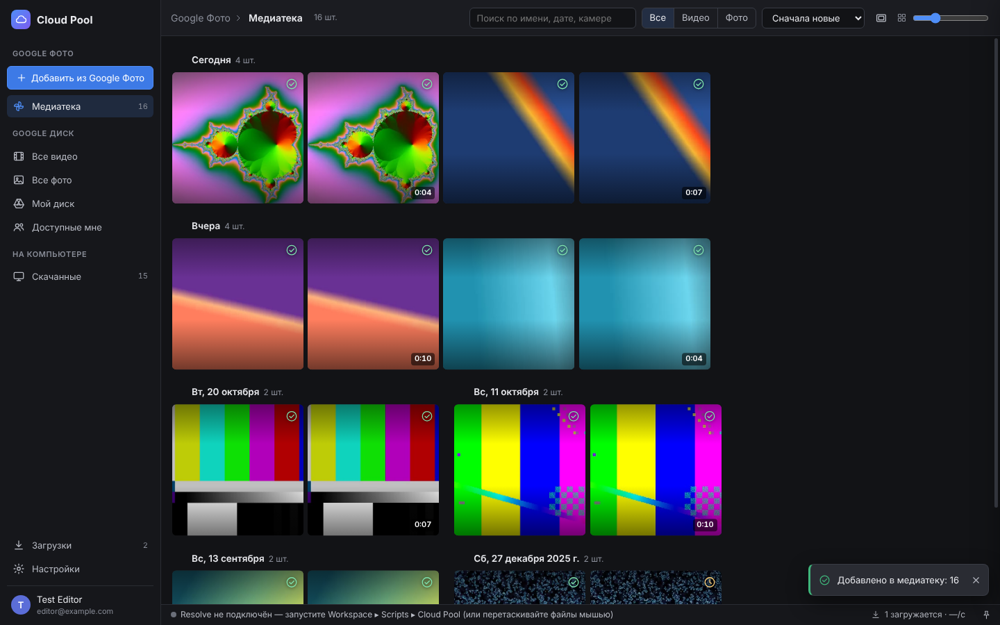
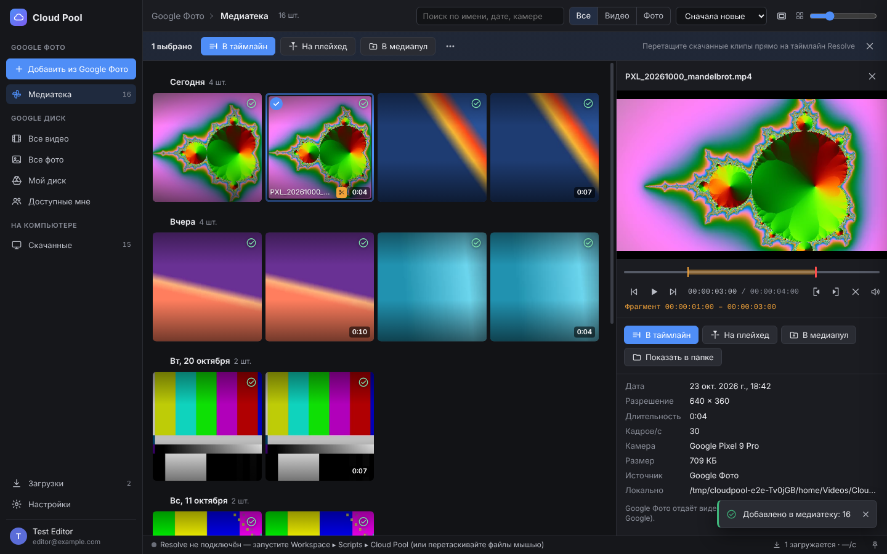
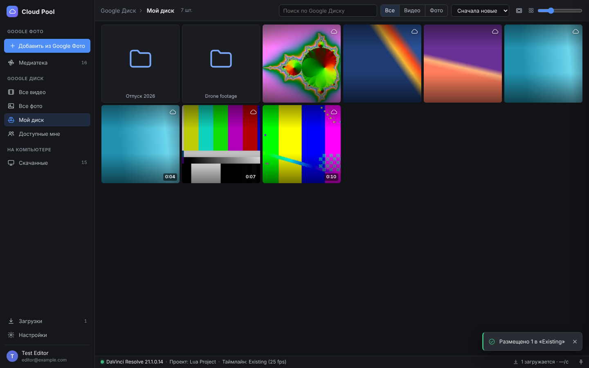
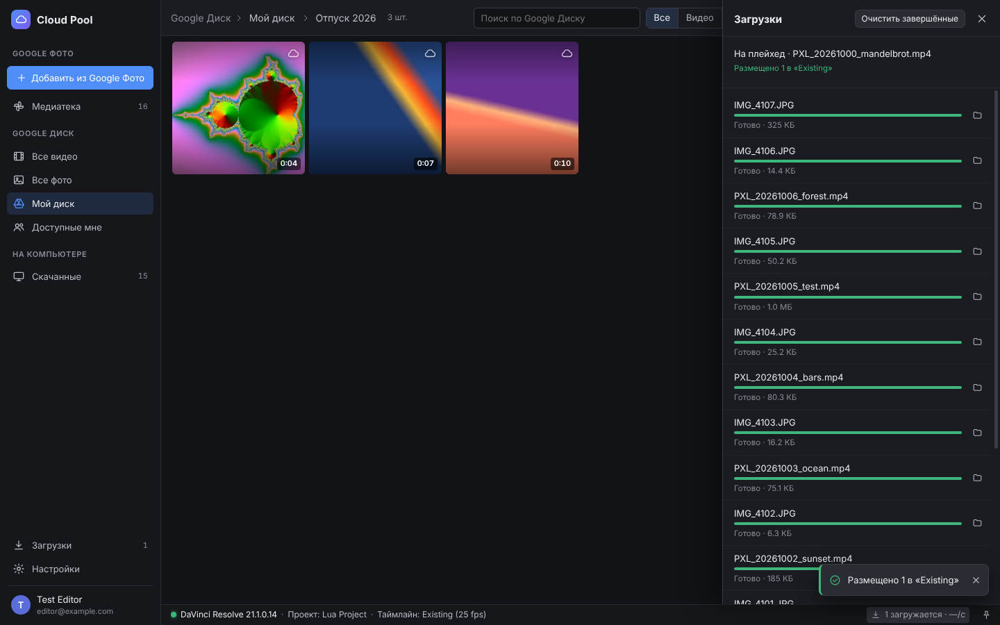
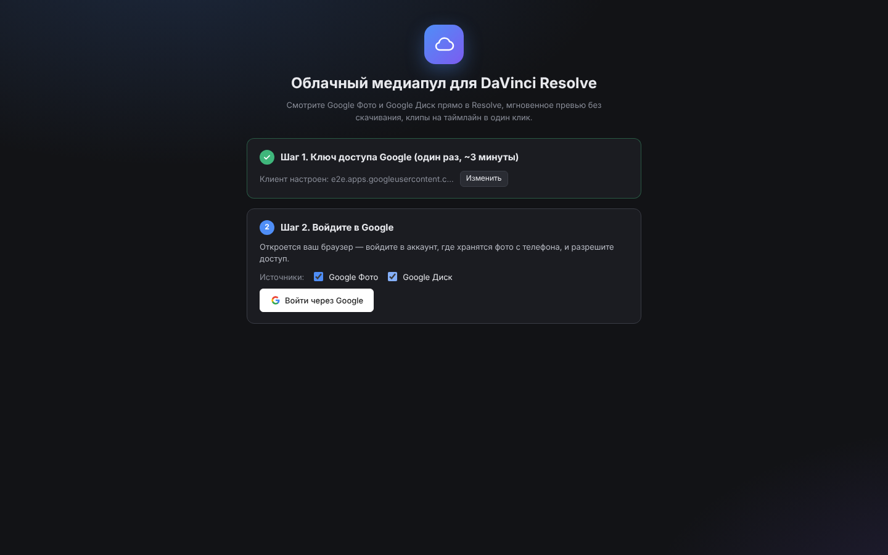

# Cloud Pool — Google Фото и Google Диск прямо в DaVinci Resolve

**Облачный медиапул для DaVinci Resolve.** Открываете окно внутри Resolve, выбираете видео из
Google Фото (то, что телефон сам туда выгружает) или с Google Диска — превью открывается мгновенно,
без скачивания, а клип одним нажатием (или перетаскиванием) встаёт на таймлайн.



## Что умеет

- **Google Фото** — окно выбора самого Google Фото с его «умным» поиском (люди, места, предметы,
  «видео с моря», даты). Выбранное попадает в медиатеку Cloud Pool и остаётся там.
- **Google Диск** — все видео, все фото, папки «Мой диск», «Доступные мне», поиск по Диску.
- **Мгновенный просмотр, как в Google Фото**: видео стримится напрямую из облака (HTTP Range),
  перемотка сразу в любое место, даже у длинных роликов — ничего не нужно скачивать заранее.
  Из облака запрашивается ровно то, что смотрите: при перемотке лишнее не докачивается.
  Превью выбранного сохраняются на диск сразу после выбора — медиатека листается мгновенно, в том числе офлайн.
- **Скимминг**: проведите мышью по плитке — видео прокручивается под курсором.
- **Просмотрщик как в Resolve**: J/K/L, покадровый шаг, точки **In/Out** — на таймлайн уходит только выбранный фрагмент.
- **В таймлайн одним действием**:
  - **В таймлайн** (Enter) — в конец текущего таймлайна;
  - **На плейхед** (F12) — в позицию плейхеда на свободную дорожку, ничего не затирая; плейхед сдвигается за клип,
    так что следующая вставка продолжает монтаж;
  - **В медиапул** (Ctrl/⌘+I), **Новый таймлайн**;
  - **Перетаскивание** скачанных клипов прямо на таймлайн или в медиапул Resolve.
  Клипы встают в том порядке, в котором вы их выбрали, — даже если докачиваются в разное время.
  Первые клипы появляются на таймлайне, пока остальные ещё качаются.
- **Быстрая загрузка оригиналов**: файл качается несколькими параллельными соединениями (как в IDM),
  с докачкой после обрыва или перезапуска, проверкой MD5 (для Диска) и приоритетом для клипов,
  которые вы отправили в Resolve. Выбранные в Google Фото видео начинают качаться сразу, в фоне.
- **Из длинного видео — только нужный кусок.** Если у ролика длиннее 45 секунд стоят метки In/Out и на компьютере
  есть [ffmpeg](https://ffmpeg.org), Cloud Pool вырезает прямо из облака только отмеченный фрагмент — без
  перекодирования, кадр в кадр, с небольшим запасом по краям. Ради 10 секунд из часового ролика не нужно
  качать гигабайты. Без ffmpeg файл просто скачивается целиком.
- **Медиатека «Скачанные»** — всё скачанное доступно офлайн; файлы раскладываются по датам.
- Сетка с группировкой по дням/месяцам, как в Google Фото, размер плиток ползунком, фильтры
  «видео/фото», сортировка (дата, имя, длительность, размер), поиск, выделение Shift/Ctrl, контекстное меню.
- Интерфейс на русском и английском, тёмная тема в стиле Resolve.

| Просмотр с In/Out | Google Диск | Загрузки |
|---|---|---|
|  |  |  |

## Как это устроено (и почему именно так)

- **Google Фото API с 2025 года** не позволяет приложениям читать всю медиатеку. Официальный путь —
  [Google Photos Picker](https://developers.google.com/photos/picker): окно Google Фото, в котором вы выбираете,
  что дать приложению. Поэтому кнопка «Добавить из Google Фото» открывает именно его — со всем поиском Google.
  Ссылки на выбранные файлы Google выдаёт временно, поэтому видео сразу начинают скачиваться в фоне
  (настраивается).
- **Видео из Google Фото** API отдаёт как высококачественный MP4 (транскод Google), а не исходный файл с телефона.
  С Google Диска скачивается оригинал без изменений.
- **Resolve монтирует только локальные файлы.** Поэтому «облачный медиапул» работает так: превью — потоком из облака,
  а при отправке в Resolve файл быстро докачивается и импортируется автоматически.

Подробнее — в [docs/ARCHITECTURE.md](docs/ARCHITECTURE.md).

## Требования

| | DaVinci Resolve **Studio** (macOS, Windows) | DaVinci Resolve **бесплатная** (macOS, Windows) | Linux |
|---|---|---|---|
| Как открывается | *Workspace ▸ Workflow Integrations ▸ Cloud Pool* | *Workspace ▸ Scripts ▸ Cloud Pool* | *Workspace ▸ Scripts ▸ Cloud Pool* |
| Что нужно | только установщик | только установщик (использует Electron, встроенный в Resolve) | [Node.js LTS](https://nodejs.org) |
| Вставка на таймлайн | кнопки, клавиши, перетаскивание | кнопки, клавиши, перетаскивание | кнопки, клавиши, перетаскивание |

Плагины Workflow Integration Blackmagic поддерживает только в **Resolve Studio** на macOS и Windows
(рекомендуется Resolve 20.1 или новее — там Electron 36 и асинхронный API). Для бесплатной версии
используется скрипт из меню *Scripts*, который работает во всех редакциях. Горячие клавиши работают
и на русской раскладке.

Ещё понадобится **OAuth-клиент Google** (бесплатно, один раз, ~3 минуты) — см. ниже.

Необязательно: **ffmpeg** — чтобы из длинных видео скачивался только отмеченный фрагмент
(macOS: `brew install ffmpeg`, Windows: `winget install Gyan.FFmpeg`). Cloud Pool находит его сам.

## Установка

### 1. Скачайте проект

Кнопка **Code ▸ Download ZIP** на GitHub (распакуйте) или `git clone`.

### 2. Создайте ключ доступа Google

Пошагово, со всеми пунктами: **[docs/GOOGLE_SETUP.md](docs/GOOGLE_SETUP.md)**. Кратко:

1. <https://console.cloud.google.com/> → новый проект.
2. Включите **Google Photos Picker API** и **Google Drive API**.
3. *Google Auth Platform*: тип **External**, свой Gmail — в **Test users**.
4. *Clients → Create client → Desktop app → Download JSON*.

Совет: положите скачанный `client_secret_….json` в папку проекта — установщик подхватит его сам.

### 3. Запустите установщик

- **Windows**: дважды щёлкните **`Install Cloud Pool (Windows).cmd`**.
- **macOS**: в Терминале `bash scripts/install-macos.sh`.

Установщик сам определит редакцию Resolve:

- **Resolve Studio** — ставит плагин в папку *Workflow Integration Plugins* (попросит права администратора)
  и берёт `WorkflowIntegration.node` из вашей установки Resolve (этот модуль Blackmagic не распространяется
  с проектом). Перезапустите Resolve → **Workspace ▸ Workflow Integrations ▸ Cloud Pool (Google Photos)**.
- **Бесплатная версия** — копирует приложение в вашу папку пользователя и ставит скрипт-мост «Cloud Pool».
  Окно запускается встроенным в Resolve Electron, Node.js не нужен. Перезапустите Resolve →
  **Workspace ▸ Scripts ▸ Cloud Pool**: скрипт откроет Cloud Pool и подключит его к Resolve
  (в строке состояния появится «DaVinci Resolve … · Проект …»). Пока скрипт работает, вставка на таймлайн
  идёт кнопками и клавишами; перетаскивание мышью работает всегда.

Если установщик сообщит, что встроенный Electron не найден (или у вас **Linux**): установите
[Node.js LTS](https://nodejs.org) и один раз запустите **`Start Cloud Pool (Windows).cmd`** /
**`start-cloud-pool.command`** (или `npm install && npm start`). Cloud Pool сам поставит скрипт-мост, и дальше
пункт *Workspace ▸ Scripts ▸ Cloud Pool* будет открывать его сам.

### 4. Первый запуск

Загрузите `client_secret….json` (если установщик его не подхватил), нажмите **«Войти через Google»** —
откроется браузер. Предупреждение «Google hasn’t verified this app» — нормально: это ваше собственное
приложение, нажмите **Continue**.



## Как пользоваться

1. **«Добавить из Google Фото»** — откроется Google Фото в браузере. Найдите нужное (поиск Google работает
   как обычно), отметьте видео и фото, нажмите **Готово**. Окно закроется, элементы появятся в Cloud Pool,
   и начнётся фоновая загрузка.
2. **Просмотр**: двойной щелчок или **Пробел**. Наведите мышь на плитку — превью; ведите мышью — скимминг.
3. **Фрагмент**: в просмотрщике **I** — начало, **O** — конец (на плитке появится значок ✂).
   У длинных видео (при установленном ffmpeg) скачивается только этот кусок — в бине он появится как
   «Имя [мм-сс_мм-сс].mp4».
4. **В Resolve**: выделите клипы (Shift/Ctrl) →
   **Enter** — в конец таймлайна, **F12** — на плейхед, **Ctrl/⌘+I** — только в медиапул.
   Можно перетащить уже скачанные (✓) клипы прямо на таймлайн.
   Клипы попадают в бин **Google Photos** / **Google Drive** (названия меняются в настройках), с комментарием
   «Google Photos · дата · камера» в метаданных клипа.
5. Значки на плитках: ☁ — в облаке, кольцо — скачивается, ✓ — на компьютере, 🕒 — Google ещё обрабатывает видео,
   ⚠ — ошибка или истёк доступ (выберите элемент в Google Фото ещё раз).

### Горячие клавиши

| Клавиша | Действие |
|---|---|
| Пробел | просмотр / воспроизведение |
| Enter, Shift+F12 | в конец таймлайна |
| F12, Shift+Enter | на плейхед (на свободную дорожку) |
| Ctrl/⌘ + I | только импорт в медиапул |
| I / O / Alt+X | начало / конец фрагмента / сбросить |
| J / K / L | назад / стоп / вперёд (повтор — быстрее) |
| ← / → | на кадр (Shift — на секунду); без просмотра — выбор плитки |
| ↑ / ↓ | выбор плитки |
| D | скачать |
| Ctrl/⌘ + A, Ctrl/⌘ + F | выбрать всё, поиск |
| + / − | размер плиток |
| Delete | убрать из медиатеки / удалить скачанный файл |

## Где что хранится

| Что | Где |
|---|---|
| Скачанные файлы | `~/Movies/Cloud Pool` (macOS), `Видео\Cloud Pool` (Windows), `~/Videos/Cloud Pool` (Linux) — меняется в настройках |
| Настройки, медиатека, кэш превью, журнал | `~/Library/Application Support/Cloud Pool for Resolve` (macOS), `%APPDATA%\Cloud Pool for Resolve` (Windows), `~/.config/Cloud Pool for Resolve` (Linux) |
| Токены Google | там же, файл `account.bin`, зашифрован системой (Keychain / DPAPI) |

Cloud Pool общается только с серверами Google. Локальный медиасервер слушает лишь `127.0.0.1`
и отвечает только на адреса со случайным секретным ключом.

## Частые вопросы

**Вход просит повториться каждую неделю.** Приложение в Google Cloud в статусе *Testing* — токены живут 7 дней.
Опубликуйте его: *Google Auth Platform → Audience → Publish app* (проверка Google для личного использования не нужна).

**«Доступ истёк — выберите снова».** Google выдаёт доступ к выбранным элементам на ограниченное время.
Всё, что успело скачаться, остаётся навсегда (вкладка «Скачанные»). Остальное — выберите в Google Фото ещё раз:
повторно выбранные элементы обновятся, а не продублируются. Не хотите ждать — оставьте включённой
автозагрузку выбранных видео.

**Видео не показывается в просмотре.** Встроенный плеер (Chromium) не умеет некоторые кодеки (например,
HEVC без аппаратной поддержки). Клип всё равно можно отправить в Resolve — он откроет его сам.

**Плагина нет в меню Workflow Integrations.** Нужен Resolve **Studio** и перезапуск после установки.
Проверьте, что в `…/Workflow Integration Plugins/com.cloudpool.googlephotos/` есть `WorkflowIntegration.node`.

**Скрипт «Cloud Pool» не виден в Workspace ▸ Scripts.** Перезапустите Resolve после установки. Если не помогло —
нажмите «Установить скрипт в Resolve» в настройках Cloud Pool. Скрипт лежит в
`…/Blackmagic Design/DaVinci Resolve/(Support/)Fusion/Scripts/Utility/Cloud Pool.lua`.

**Как скачивать только фрагменты длинных видео?** Установите ffmpeg (`brew install ffmpeg` на macOS,
`winget install Gyan.FFmpeg` на Windows). Cloud Pool ищет его в PATH, Homebrew, WinGet, Scoop и Chocolatey —
результат виден в *Настройки ▸ DaVinci Resolve*; если не нашёл, нажмите «Указать ffmpeg…». Фрагмент
начинается с ключевого кадра чуть раньше точки In (так устроено копирование без перекодирования), поэтому
у клипа в Resolve есть запас по краям, а In/Out выставлены точно. Если вырезать не получилось, Cloud Pool
сам скачает файл целиком.

**Журнал ошибок**: Настройки ▸ О программе ▸ Журнал.

## Удаление

`Uninstall Cloud Pool (Windows).cmd` или `bash scripts/uninstall-macos.sh` — удаляют плагин, приложение и скрипт.
Скачанные файлы и настройки остаются.

## Для разработчиков

```bash
npm install          # Electron 36 (как в Resolve 20.1/21) и Playwright
npm start            # приложение в standalone-режиме
npm test             # модульные тесты (node:test): OAuth, Picker, Drive, загрузчик, медиасервер, MP4, фрагменты (ffmpeg), Resolve-размещение, Lua-мост
npm run test:e2e     # сквозной тест: Electron + фейковый Google + фейковый Resolve через реальный Lua-скрипт (Linux: xvfb-run)
```

Сквозной тест и большинство модульных работают против встроенного **фейкового сервера Google**
(`test/support/fake-google.js`): OAuth, Picker API, Drive API, раздача медиа с Range — реальный аккаунт не нужен.
Lua-мост проверяется под LuaJIT с фейковым Resolve (`test/support/fake_resolve.lua`).

Структура:

```
plugin/                    ← готовая папка плагина (без npm-зависимостей)
  manifest.xml             ← описание Workflow Integration
  main.js, preload.js      ← главный процесс Electron и мост к UI
  src/main/                ← ядро: oauth, photos (Picker), drive, media-server, thumbs, downloader, mp4, jobs
  src/main/resolve/        ← размещение в Resolve, мосты WorkflowIntegration / Lua-почтовый ящик, таймкоды
  resolve/Cloud Pool.lua   ← скрипт-мост для Workspace ▸ Scripts (все редакции Resolve)
  ui/                      ← интерфейс (ES-модули без фреймворков)
scripts/                   ← установщики, генерация иконок
test/                      ← модульные и сквозной тесты
docs/                      ← инструкции и архитектура
```
